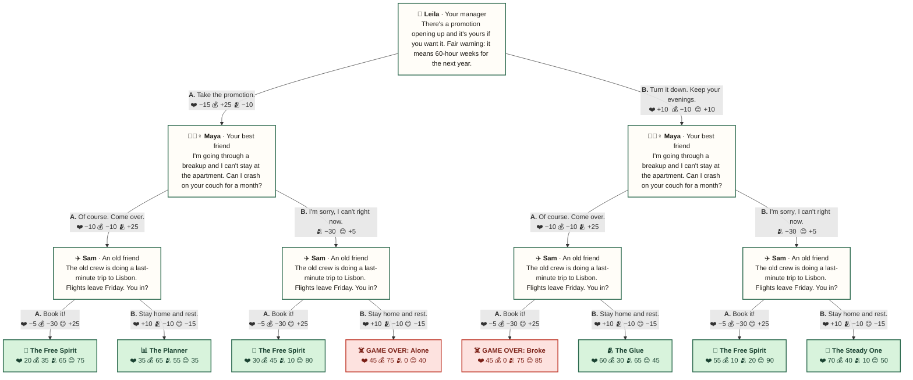

# Decision tree

<!-- Generated by scripts/tree.ts from src/data/cards.ts. Don't edit by hand: run `npm run tree`. -->

Every path through the game's 3 decisions. Every meter starts at 50 (❤️ 50  💰 50  🫂 50  😊 50). A path ends early if a meter hits 0 or 100.

## All paths

| Path | ❤️ Health | 💰 Money | 🫂 People | 😊 Happiness | Result |
| --- | --- | --- | --- | --- | --- |
| A → A → A | 20 | 35 | 65 | 75 | The Free Spirit |
| A → A → B | 35 | 65 | 55 | 35 | The Planner |
| A → B → A | 30 | 45 | 10 | 80 | The Free Spirit |
| A → B → B | 45 | 75 | 0 | 40 | ☠️ **Alone** (game over) |
| B → A → A | 45 | 0 | 75 | 85 | ☠️ **Broke** (game over) |
| B → A → B | 60 | 30 | 65 | 45 | The Glue |
| B → B → A | 55 | 10 | 20 | 90 | The Free Spirit |
| B → B → B | 70 | 40 | 10 | 50 | The Steady One |

8 paths: 2 end in a game over, and 6 make it through.
