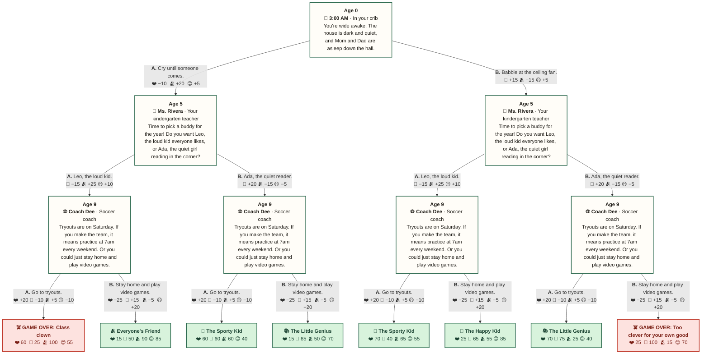

# Decision tree

<!-- Generated by scripts/tree.ts from src/data/cards.ts. Don't edit by hand: run `npm run tree`. -->

Every path through the game's 3 decisions. Every meter starts at 50 (❤️ 50  🧠 50  🫂 50  😊 50). A path ends early if a meter hits 0 or 100.

## All paths

| Path | ❤️ Health | 🧠 Smarts | 🫂 People | 😊 Happiness | Result |
| --- | --- | --- | --- | --- | --- |
| A → A → A | 60 | 25 | 100 | 55 | ☠️ **Class clown** (game over) |
| A → A → B | 15 | 50 | 90 | 85 | Everyone's Friend |
| A → B → A | 60 | 60 | 60 | 40 | The Sporty Kid |
| A → B → B | 15 | 85 | 50 | 70 | The Little Genius |
| B → A → A | 70 | 40 | 65 | 55 | The Sporty Kid |
| B → A → B | 25 | 65 | 55 | 85 | The Happy Kid |
| B → B → A | 70 | 75 | 25 | 40 | The Little Genius |
| B → B → B | 25 | 100 | 15 | 70 | ☠️ **Too clever for your own good** (game over) |

8 paths: 2 end in a game over, and 6 make it through.
